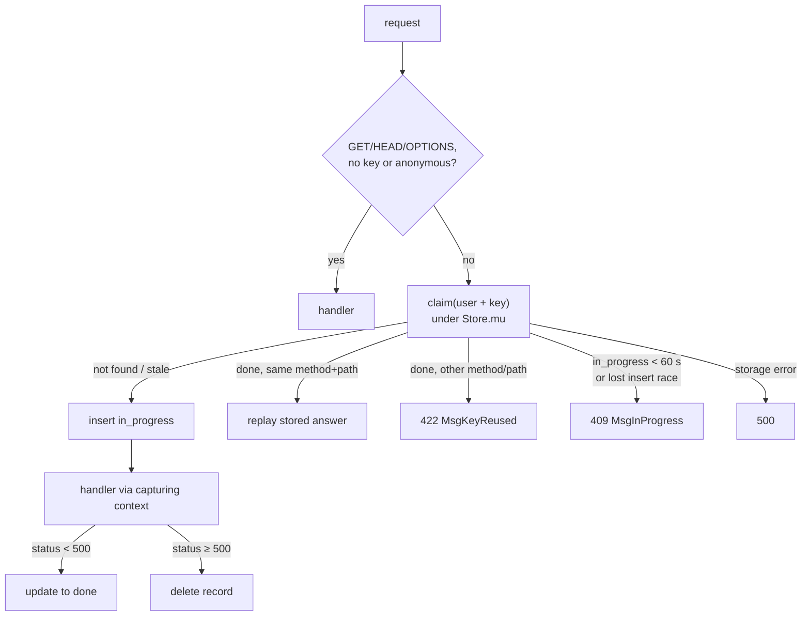

# Architecture

## Behaviour (normative)

Errors are unexported typed constants (`type idemError string` + `Error()`), never `errors.New`.
`New` with nil `db` or `now` → `idempotency: db and now are required`.

The middleware, for every request:
1. Method is `GET`, `HEAD` or `OPTIONS`, the header `router.HeaderIdempotencyKey` is absent or
   empty, **or `ctx.UserID()` is empty** → call the next handler unchanged. An anonymous caller has
   no scope: storing its key would let any other anonymous caller who guesses it (outbox keys are
   time-based ids) read the stored answer.
2. `id = ctx.UserID() + "\x1f" + key` (keys are scoped per user).
3. `claim` looks the record up by `id` **and** inserts the new `in_progress` record while holding
   `Store.mu`, so two concurrent requests with the same key in one process never both run the
   handler, even on a backend without a primary-key check (`storage/mem`). Across processes the
   primary key does it: a failed insert answers `409`. The response is written after the lock is
   released.
   - **not found** → insert `{id, method, path, state: "in_progress", created_at: now()}`; run the
     next handler through the **capturing context**; then update the record (only `state`,
     `status`, `body`, `content_type`) to `done` with the captured status (200 when the handler
     never called `WriteStatus`), body and content type.
   - **found, `done`, same method and path** → write the stored `Content-Type` (if any),
     `Idempotent-Replayed: true`, the stored status and body. **The handler is not called.**
   - **found, `done`, different method or path** → `422` with body `MsgKeyReused`.
   - **found, `in_progress`, created less than 60 s ago** → `409` with body `MsgInProgress`.
   - **found, `in_progress`, created 60 s ago or more** (the first request crashed) → delete that
     attempt (matched by `id` **and** its `created_at`) and continue as "not found".
   - **storage error on lookup or stale delete** → `500` with body `idempotency: storage
     unavailable`; nothing ran.
4. Handler responses with status ≥ 500 are **not** stored: the in-progress record is deleted so a
   retry runs again (a server failure is not an answer).

`Purge(before)` deletes `done` records created before `before`, **and** `in_progress` records
created before `min(before, now − 60 s)`: a request that crashed and was never retried would
otherwise stay in the table forever.

**Capturing context:** embeds `router.Context`; overrides `WriteStatus`, `Write` and `SetHeader`
(record and forward) and `Encode` (encodes with `webtyp.com/json`, sets
`Content-Type: application/json`, then goes through its own `Write`).

## Limitations

- The handler's own writes and the `done` update are not one transaction. If the update fails
  (the answer is already on the wire), the record stays `in_progress`, turns stale after 60 s and
  the next retry runs the handler again. Handlers that must never run twice still need their own
  guard (the modules of the offline-first wave reject a repeated `Create` with the same `Id`).
- Only `Content-Type` is replayed among the headers.
- `Content-Type` is matched with that exact spelling in `SetHeader`.
